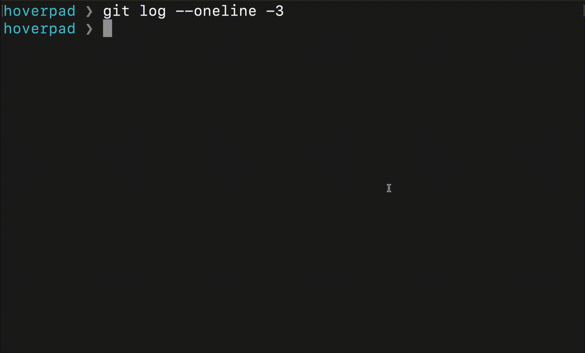

# Hoverpad

Tiny native macOS scratchpad that floats over everything, **even full-screen apps**. Paste the steps or commands you're following (from Slack, docs, a ticket), keep them in view over your full-screen terminal, edit, copy.

One Swift file, no dependencies, no Xcode project.



## Features

- Always on top, on every Space, including over full-screen apps
- Global hotkey **⌃⌥⌘P** to show/hide; **Esc** hides and hands focus back
- Multiple windows, tabs per window
- Per-tab views: **raw text**, **markdown** preview (one-click copy on code blocks), **JSON** (pretty-printed, key order kept, errors shown with line/column)
- Text tools: bold, italic, code, code block, bullets, heading, sort/trim/dedupe lines, upper/lower case, JSON format/minify
- Opacity, font size, soft wrap, float on top, all set per window
- Plain text that stays byte-exact (no smart quotes or dashes), so pasted commands still run
- Menu-bar icon, no Dock icon; everything auto-saves

## Download

Grab `Hoverpad-<version>.zip` from [Releases](https://github.com/nfsergiu/hoverpad/releases/latest), unzip, and move `Hoverpad.app` to `/Applications`. Universal (Apple silicon + Intel), macOS 13+.

The app is ad-hoc signed, not notarized, so macOS blocks the first launch. Clear the quarantine flag:

```bash
xattr -dr com.apple.quarantine /Applications/Hoverpad.app
```

or try to open it once, then click **Open Anyway** in System Settings → Privacy & Security.

To start it at login, enable **Start at Login** from the menu-bar icon.

## Build from source

Requires macOS 13+ and the Xcode Command Line Tools (`xcode-select --install`).

```bash
git clone https://github.com/nfsergiu/hoverpad.git && cd hoverpad
./install.sh
```

`install.sh` builds the app, copies it to `~/Applications/Hoverpad.app`, enables start at login (a LaunchAgent you can toggle from the menu), and launches it.

To only build without installing, run `./build.sh`; it produces `Hoverpad.app` in the repo folder.

## Shortcuts

| Keys | Action |
|---|---|
| ⌃⌥⌘P | show / hide all windows (global) |
| Esc | hide all |
| ⌘N / ⌘T | new window / new tab |
| ⌘W / ⇧⌘W | close tab / close window |
| ⌘1 / ⌘2 / ⌘3 | raw / markdown / JSON |
| ⌘B / ⌘I / ⌘E / ⇧⌘E | bold / italic / inline code / code block |
| ⌘= / ⌘- | font size |
| ⇧⌘] / ⇧⌘[ | next / previous tab |

## Data

State (windows, tabs, text, settings) lives in `~/Library/Application Support/Hoverpad/state.json`.

## Uninstall

```bash
pkill -x Hoverpad; rm -rf ~/Applications/Hoverpad.app ~/Library/LaunchAgents/local.hoverpad.plist ~/Library/Application\ Support/Hoverpad
```

## License

MIT
